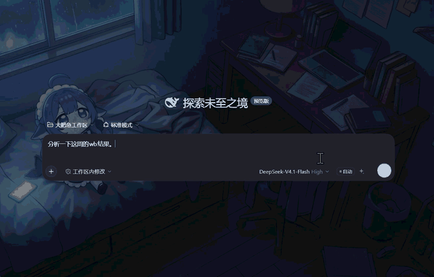
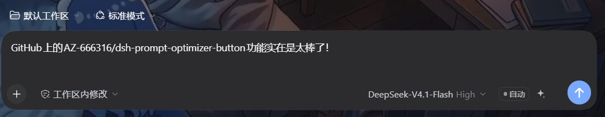
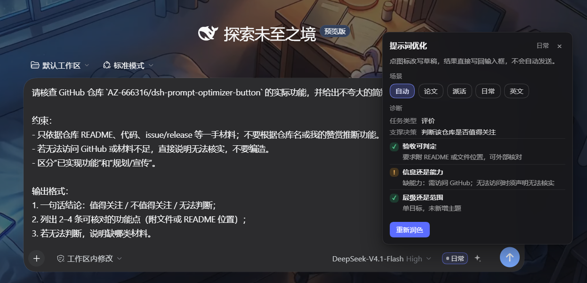
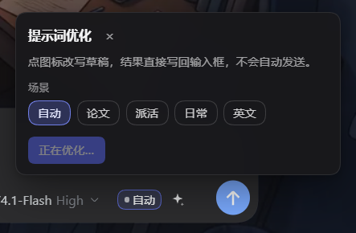

# dsh-prompt-optimizer-button

<p align="center">
  
</p>

## 演示

<p align="center">
  
</p>

录屏约 8 秒：输入草稿 → 点星星 → 面板弹出（场景 + 三条自检）→ 改写结果直接替换回输入框。

## Codex / 其他 agent 用法（skill）

Codex 的输入框没有插件接口，做不到在 composer 里加按钮；但可以用 **skill** 版：`skills/prompt-optimizer/SKILL.md`，规则与宿主侧一致（判场景 + 三自检 + 四问 + 长度红线 + 固定输出格式）。

安装 `skills/prompt-optimizer/` 到下面任一位置即可：

- Codex：`~/.codex/skills/prompt-optimizer/`，或 `~/.agents/skills/prompt-optimizer/`（DSH 与 Codex 共用）
- DSH：用户级 `~/.dsh/skills/prompt-optimizer/`，或项目级 `.dsh/skills/prompt-optimizer/`

调用方式：Codex 里说“优化这个提示词”，或显式 `$prompt-optimizer`；DSH 里可用 `/prompt-optimizer`。具体前缀取决于所用客户端的 skill 调用语法。

Codex 里唯一“发送前”的钩子是 `UserPromptSubmit` hook，但它只能阻断或注入上下文、不能替换输入框内容，所以本插件不依赖它（详见 [Codex hooks](https://developers.openai.com/codex/hooks)）。

## 截图

<p align="center">
  <br>
  <sub>输入框里：场景徽标 + 优化按钮，位于模型选择器与发送按钮之间</sub>
</p>

<p align="center">
  <br>
  <sub>诊断面板：场景 chips、任务类型与支撑决策、三条自检（✓ / !）</sub>
</p>

<p align="center">
  <br>
  <sub>优化进行中：按钮呼吸闪烁，面板显示“正在优化…”</sub>
</p>

给 DSH 输入框加一个「优化提示词」小图标（sparkle）按钮，并在它旁边加一个场景徽标：位置在 **模型选择框与发送按钮之间**（麦克风/发送按钮左侧）。

点一下图标，插件会把当前草稿发给宿主侧的一小段服务，用**当前选中的模型**跑一次普通的模型调用，把改写后的提示词**直接替换回输入框**：

- 不发送、不新增对话轮次，你先看、先改，再按 Enter；
- 使用输入框里当前选的 provider/model（含 reasoning effort），不另配密钥；
- 草稿为空时按钮置灰；请求进行中图标呼吸闪烁、按钮不可再点；失败时图标变红并自动打开面板说明原因；
- 徽标显示模型这次判断出的场景（自动 / 论文 / 评估 / 派活 / 日常 / 英文），点徽标可打开面板、手动钉住下一次要用的场景；
- **撤销**：润色改写输入框后，徽标与按钮之间会出现一个「↶」按钮，点一下就能把草稿恢复成**这次润色之前**的原文；最多可以连续撤销 10 次。一旦你在输入框里手动改过内容（或继续做下一次润色），当前这步的撤销机会就收起，避免误把你自己的编辑覆盖掉。

## 场景徽标与诊断面板

一次调用同时返回三样东西：改写后的提示词（写回输入框）、判断出的场景、以及结构化诊断。诊断不进输入框，只显示在弹出面板里：

- 面板标题行右侧显示模型识别到的场景，正文依次是：功能提示、场景选择 chips（自动/论文/评估/派活/日常/英文，点一下即钉住；末尾 `＋` 可新建自定义场景）、诊断（任务类型、要支撑的决策）与三条自检（✓ 通过 / ! 未通过，各带一句理由）、失败原因（仅失败时）；
- 自定义场景：点 chips 末尾的 `＋`，填「名称」和「说明/提示词」后保存，会与预设场景并列显示，点一下即可使用；每个自定义场景右侧带 `✎`（编辑，改后点「保存修改」）和 `×`（删除）；
- 预设场景也能改：论文 / 评估 / 派活 / 日常 / 英文 五个内置场景同样带 `✎`（重命名、追加额外说明；内置规则仍然生效，说明叠加在它们之后）和 `×`（暂时隐藏，不删除内置规则）；隐藏后 chips 下方会出现「恢复隐藏的预设场景」；预设被改过时名称显示为浅紫色，编辑表单里可点「恢复默认」；
- 所有改动存在浏览器 `localStorage`（键 `dsh-prompt-optimizer-button:scenario-config`，旧版自定义场景会自动迁移），只影响本机这一份界面，刷新后仍在；
- 面板用 `position: fixed` 挂在按钮上方（空间不足自动翻到下方），水平居中并夹在视口内；外部点击、`Escape`、关闭按钮都能收起；`role="dialog"`；
- 视觉为深色半透明 + 背景模糊 + 圆角 14 + 投影，徽标是圆点 + 文字的胶囊；按钮禁用态用 `aria-disabled`（原生 `disabled` 会让 Chromium 不派发指针事件），点击守卫仍在 `onClick` 里。

## 项目评估（评估 / repo）场景

「在别处看到感兴趣的 GitHub / 网站项目，想知道它是什么、能不能用在我这儿」是一类独立任务：它既不是论文改稿，也不是给 agent 派活，而是一个**带环境约束的引入决策**。这类草稿通常只有一句话加一个链接，直接发给 agent 会得到百科式介绍，拿不到「能不能用」的结论，所以单独开了一个场景（chips 里显示为「评估」）。

判定规则：草稿里出现项目链接或明确项目名，且核心决策是「用不用它」（适不适合我的环境、能不能接进来、要不要换掉现有方案）→ 按评估处理；只是拿某个仓库当代码来源让我改代码 / 改文档 → 按派活处理；论文语境里没有引入意图（只是引用、核对、改稿）→ 按论文处理。英文草稿先判实质场景，语言叠加照常。

改写策略固定为一条决策链，不做横向清单：

1. **身份**：确认 owner/name 与官方主页，排除同名仓库、镜像、fork、已归档旧仓库；给不出就写【待补】。
2. **一手证据 + 时效**：事实只取 README、releases/tags、LICENSE、依赖清单、最近 commit、开放 issue，并写核查日期；不许凭记忆报版本号、star 数、API 或平台兼容性，拿不到就标「未核实」，没联网就写成能力缺口。
3. **环境硬约束**：先列环境事实（OS 与版本、运行时 / 包管理器、已有依赖与插件体系、权限 / 沙箱 / 网络边界），草稿没给的标【待补】；再把项目要求逐项对照，每项给「匹配 / 需额外配置 / 冲突」+ 依据。
4. **最小验证**：在临时目录按官方文档跑最小一步，给出原样命令、通过判据、失败怎么回滚。
5. **结论与反证**：三选一「现在能用 / 改造后用（成本 + 第一刀改哪）/ 不用（替代方案）」，写前提与可证伪条件；不用 star 数、热度或 README 营销话术当结论；用途落在论文 / 科研时，把「工具能跑通」与「结果可用于论文（稳定性、可重复性、证据边界）」分开写。

改写长度上限 700 字（比论文 / 派活的 650 字略宽，因为决策链更长），验收表必须外部可核对（事实带版本与日期、环境匹配有依据、结论可证伪）。

完整策略与 3 组 before / after 示例见 [`docs/repo-eval-scenario.md`](docs/repo-eval-scenario.md)。

## 结构

```
dsh-prompt-optimizer-button/
├─ package.json        # dsh.bundle.patch + dsh.client
├─ cordis.patch.yml    # 往 profile 组合里插入 host 行
├─ index.js            # 宿主侧：POST /prompt-optimizer/rewrite（ctx.llm 一次调用）
├─ client.js           # 浏览器侧：__ModuleLoader__ bundle，按钮 + portal 定位 + fetch
├─ assets/             # 图标与截图
├─ docs/               # 场景策略文档（不进 npm 包）
├─ skills/prompt-optimizer/SKILL.md  # Codex / 其他 agent 的 skill 版
├─ publish/            # 商店上架草稿：awesome-entry.yml、CHECKLIST.md、PR_BODY.md
└─ README.md
```

- 浏览器侧注册 `conversation.input.right` 单元格，用 `ReactDOM.createPortal` 把徽标与按钮插到 composer trailing 行的 `standardControls`（模型选择器块）之后；诊断面板再 portal 到 `document.body`，用按钮矩形算固定定位坐标。
- 宿主侧注册一条同源路由 `POST /prompt-optimizer/rewrite`：
  `{ text, provider, model, reasoningEffort?, scenario? } → { ok: true, text, scenario, diagnosis }`。
  `text` 是改写后的提示词（唯一写回输入框的内容），`scenario` / `diagnosis` 只给面板用。
  桌面版页面 origin 是 `dsh-app://app`，主进程会把非本地资源的 fetch 转发到宿主 Web 服务器（带认证 cookie），所以相对路径 `fetch('prompt-optimizer/rewrite')` 在桌面与网页版都能用。
- 模型答案用行标记解析（`SCENARIO:` / `DIAGNOSIS:` / `PROMPT:`），长提示词正文不塞进 JSON 字符串，避免换行与引号导致解析失败；解析失败时回退为「整段当提示词」。

- 宿主侧不 `import` 任何 `@deepseek-ai/*` 包（profile 里并没有 dsh-llm），只通过 `ctx.get('llm')` / `ctx.inject(['webServer'])` 拿运行时服务，避免插件拖慢或拖垮启动握手。

## 依赖

- 运行中的 DSH（0.2.2 级别）自带 `llm`、`webServer` 服务即可，无需额外包。
- 不再依赖 `prompt-optimizer` 技能：优化规则写在 `index.js` 的 system prompt 里（技能仍是给对话用的，两者不冲突）。

## 安装

本机已通过 `plugin_manager` 的 `install_bundle` 以 `link:` 方式装到 `desktop` profile。手动安装等价于：

1. 在 profile（如 `%USERPROFILE%\.dsh\profiles\desktop\package.json`）的 `dependencies` 加
   `"dsh-prompt-optimizer-button": "link:<本目录绝对路径>"`；
2. 把 `dsh-prompt-optimizer-button` 加进 `dsh.profile.bundles`；
3. 让 profile 重新组装（`plugin_manager` 的 set/install，或重启 DSH），页面刷新后生效。

## 卸载

- `plugin_manager` 里禁用/移除 `prompt-optimizer-button` 行，或
- `dsh plugin --profile desktop remove dsh-prompt-optimizer-button`。

## 已知限制

- DSH 0.2.2 的 composer 内部 DOM 不是公开 API；升级后若 `[data-composer-card]` / `standardControls` 结构变化，按钮定位会失效（有「发送按钮前」的兜底定位）。
- 按钮只在会话输入框出现（欢迎 hero 态没有该单元格）。
- 宿主路由不做额外鉴权，依赖 Web 服务器本身只在 loopback 暴露；若要对外暴露需自行加策略。
- 单次请求上限：输入 20k 字符、输出 4000 tokens、超时 90 秒；输出被 max tokens 截断时，若已解析出完整提示词则保留并标记，否则提示缩短草稿重试。
- 目前不自动发送；要「点完直接发送」改 `client.js` 的 `onClick`，在 `setDraft` 后调用 `inputActions.submit()`。
- 自定义场景与预设改动只存在本机浏览器（`localStorage`），换设备/换浏览器不会同步，也不会影响别人的界面。
- 场景判定由模型在当次调用里完成，可能判偏；不认同可以在面板里点 chip 钉住场景后重跑（目前不会跨会话记住你的选择）。
- 评估场景依赖草稿里出现项目链接 / 名称与采用意图；只丢一个仓库名又没说要干什么时，可能被判成日常提问，钉住「评估」chip 再跑即可。
- 评估场景对「未联网 / 读不到仓库」的处理是标「未核实」并写成能力缺口，不会替你猜版本号或兼容性；要更可靠的事实，请在会话里直接让 agent 抓取一手材料。
- 重命名预设但不填额外说明时，只改界面显示名，不改模型行为（内置规则不动）；要改变行为请在「说明/提示词」里追加要求。
- 英文面板文案已支持（跟随 DSH 语言），但仓库文档目前只有中文 README；Codex 侧是 `skills/` 里的 skill 版，没有 composer 按钮。
