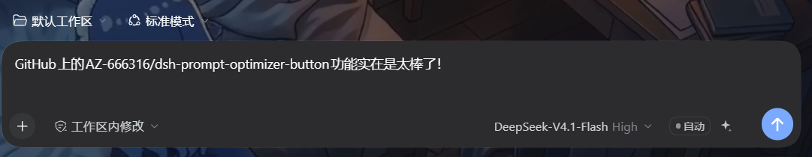
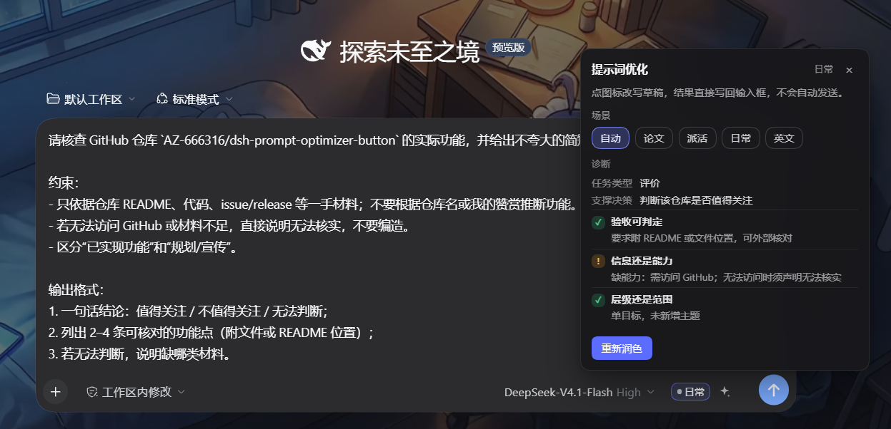

# Add AZ-666316/dsh-prompt-optimizer-button

## What it is

A DSH client plugin that puts a small sparkle button and a scenario badge inside the
composer, between the model selector and the send button. Clicking the sparkle rewrites the
current draft **in place** with the model already selected in the composer — no extra chat
turn, no assistant message; the draft stays editable before sending.

It classifies the draft into one of four scenarios (paper / agent task / daily question /
English writing), runs a three-check diagnosis, and shows the result in a compact panel:
acceptance testable? missing information or capability? raising depth or widening scope?
A scenario can be pinned manually for the next rewrite.

## Why it is different

Existing prompt optimizers are separate apps or browser extensions that open their own
window. This one lives inside the agent harness composer, calls the model already selected
for that session (including its reasoning effort), and returns the rewritten draft to the
same input box without creating a turn. It is also the only one I found that returns a
structured, three-check diagnosis next to the scenario label.

## How it works

- Host half: one exact HTTP route `POST /prompt-optimizer/rewrite`; it uses `ctx.llm` with a
  single call and a compact system prompt. No `@deepseek-ai/*` imports, so it cannot block
  the desktop startup handshake.
- Browser half: a hand-written `window.__ModuleLoader__` bundle. It registers a cell in
  `conversation.input.right` and uses `ReactDOM.createPortal` to place the badge/button after
  the composer's `standardControls` block; the diagnosis panel portals to `document.body`.
- Desktop pages (`dsh-app://app`) reach the route through the shell's fetch forwarding, so
  the same relative `fetch()` works in the web build and the desktop build.

## Compatibility

- `package.json` declares `dsh.bundle.patch` and the repo has `cordis.patch.yml` at its root.
- `engines.dsh`: `>=0.2.2-rc.1 <0.3.0-0`.
- Published on npm as `dsh-prompt-optimizer-button` (repository field points here).
- Codex / other agents: the same rules are shipped as a skill at
  `skills/prompt-optimizer/SKILL.md` (install into `~/.codex/skills` or `~/.agents/skills`).

## Screenshots

## Maintenance

Solo maintainer, issues and PRs handled in the repository above.
